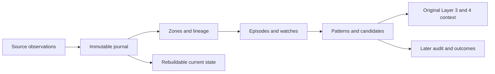

# Persistent State Machine and Storage Schema

Status: **Frozen design, version 1.0 — 2026-10-29.**

This document consolidates the persistence requirements of frozen [Layer 1](layer_1_zone_discovery.md), [Layer 2](layer_2_price_reactions.md), [Layer 3](layer_3_environmental_context.md) and [Layer 4](layer_4_multitimeframe_alignment.md). The user confirmed SQLite on local storage, one engine writer and multiple read-only viewers. The storage contract and logical schema below are frozen for version 1.0; the layer rules remain authoritative.

Frozen means agreed for implementation planning, not implemented or operationally validated. Executable migrations and implementation details must preserve this contract. Changes require an explicit revision.

## 1. Goal and scope

The application must retain morning observations, resume after a restart, prevent duplicate episodes/candidates, and reconstruct what each decision actually knew. A process restart must not move a frozen zone, reset test counts, extend a setup deadline or release a historically blocked trigger.

Store validated source observations and immutable domain events as the durable record. Maintain small current-state projections for efficient operation; rebuild them from the recorded events if necessary. Historical replay may also rerun deterministic layer logic over the original available inputs to verify the recorded results.

This is persistence for a research signal application. Option orders, fills, balances, portfolio reservations and broker reconciliation are outside this design. Keep forward outcomes separate from entry inputs. Do not create an SQS column that implies a score formula has been approved.

## 2. Agreed deployment

Use one SQLite database, default path `spx-gex-agent/data/spx_gex.sqlite3`, on local storage. One engine process owns writes. Additional TUI/chart processes use read-only queries and do not independently poll, evaluate or insert candidates.

SQLite WAL permits concurrent readers while writes remain serialized. It is appropriate for this single-host topology; WAL is not a network-filesystem deployment mechanism. PostgreSQL is a future option if actual requirements expand to multiple hosts/writers. Do not build both adapters in version 1. [SQLite WAL](https://sqlite.org/wal.html), [transactions](https://sqlite.org/lang_transaction.html).

Connection policy: WAL, `synchronous=FULL`, explicit bounded busy handling, short write transactions and `foreign_keys=ON` on every connection. Verify the selected SQLite runtime supports the chosen schema and read-only WAL configuration. Foreign-key enforcement must be enabled explicitly. [SQLite foreign keys](https://sqlite.org/foreignkeys.html).

Acquire an OS-held exclusive writer lock associated with the canonical database identity before polling or recovering. It is released by process termination; a PID file or stale heartbeat alone is not ownership. A second engine must report that a writer already exists and offer/read as an explicit viewer; it must not silently become another producer. All paths to this database, including maintenance, must obey the same ownership policy. Resolve aliases consistently and reject unsupported path aliases rather than creating independent locks.

The lock prevents competing engines; uniqueness constraints and idempotent commits still protect retries. Different databases intentionally define different research stores, not a shared portfolio. Opening two viewer windows may display the same candidate twice on two screens, but creates only one stored candidate.

## 3. One storage module with a small interface

Use a storage module that owns transaction ordering, uniqueness, causal reads and recovery. Layer evaluators receive typed as-of inputs and return proposed events; they do not issue arbitrary SQL or read outcome tables.

The recommended interface exposes a few cohesive operations:

- `record_observation(batch)`: validate provenance, retain revisions and publish complete input observations idempotently.
- `load_asof(stream, cutoff)`: return only inputs and events visible at the supplied time and event cursor.
- `commit_transition(stream, expected_cursor, result)`: atomically append events, update projections and create delivery intents.
- `restore(stream)`: load compatible state and replay any committed tail.
- Read-only query operations for dashboard/history and separate evaluation operations for outcomes.

Tests should exercise retries, crash recovery and causal visibility through this same interface. An implementation seam for outcome access must keep it unavailable to live entry evaluators; SQLite table naming alone is not an access restriction.

## 4. Identities and clocks

Never identify a snapshot solely by its timestamp, or a candidate solely by time and CALL/PUT side. Store canonical identifiers and full identity fields, not an unexplained hash alone.

| Field | Meaning |
|---|---|
| `source_ts` / bar start/end | When the underlying observation describes the market |
| `snapshot_asof_ts` | Valuation cutoff used to select snapshot inputs |
| `available_ts` | When validated complete evidence was published to the engine's causal stream |
| `recorded_ts` | Persistence/audit time; not a substitute for historical availability |
| `event_seq` | Monotonic total ordering in this database's journal |
| `decision_cutoff_seq` | Last observed event permitted in a particular decision |
| `stream_id` | Evaluation namespace: session, configuration, universe and live/replay identity |
| `process_run_id` | One process lifetime; diagnostic only, never a new strategy identity after restart |

Store timestamps in a consistent UTC integer representation with documented precision; retain ET session date/calendar and provider timezone semantics. Price identities and zone geometry use canonical scaled integers or exact decimal encoding. Computed GEX and ratios may use finite real values with explicit units; missing values are null plus reasons.

Availability is not assigned from the scheduled polling boundary or HTTP request start. Uncommitted/staged data is invisible to the strategy. Publication ordering must record when complete evidence becomes eligible, and decisions must enforce both availability time and event cursor. Same-clock-time later events cannot leak into earlier decisions. A failed transaction cannot advance visibility.

## 5. Logical schema: metadata and source evidence

`PK` denotes a primary key, `FK` a foreign key and `UQ` a uniqueness constraint. These are the agreed logical tables; executable migrations are separate implementation work.

| Table | Keys and important fields | Contract |
|---|---|---|
| `schema_migrations` | PK version; checksum, applied time, application compatibility | Migration audit; never edit an applied migration silently |
| `config_versions` | PK config ID; UQ canonical content hash; parameters, model/code/calendar versions | Immutable configuration used by all derivations |
| `streams` | PK stream ID; session, mode, experiment, config FK, universe, source-stream reference | LIVE, recorded-input replay and retrospective reconstruction remain distinct |
| `process_runs` | PK run ID; stream FK, start/end, host, last heartbeat, shutdown reason | Operational history; heartbeat is not the writer lock |
| `ingest_batches` | PK batch ID; provider/request identity, poll job, source revision/hash, received time, status, payload | Retain accepted inputs and failed requests; distinguish retries from genuine revisions |
| `journal` | PK event sequence; UQ event ID/idempotency key; stream, kind, source/availability/record times, cause ID, payload schema version | Append-only ordering of input publication, state transitions and observations |
| `bars` | PK bar revision ID; batch/publication event FKs; symbol, interval, start/end, OHLC, volume, revision/hash, quality | Immutable revisions, not overwrite-in-place candles; UQ provider/logical interval/revision identity |
| `oi_baselines` | PK baseline ID; report session, exact universe, provider, publication event, completeness/provenance | Independent OI universe, never inferred from returned quotes |
| `oi_contracts` | PK (baseline ID, contract key); OI and validity | Contract key includes root, expiry, right and exact strike |
| `gex_snapshots` | PK snapshot ID; batch, baseline, config and publication FKs; role, as-of, spot, corridor, health, coverage and totals | Role LOCAL or BROAD; each has independent quality status |
| `gex_contracts` | PK (snapshot ID, contract key); quote/source times, baseline OI, valuation/Greeks, gross/net, inclusion and exclusion reasons | Preserve missing/unusable baseline contracts explicitly; no invented zero exposure |

For snapshots, enforce uniqueness on the actual capture revision, valuation cutoff, universe, model/configuration and role. LOCAL and BROAD may derive from the same captured chain, but the broad quality result cannot overwrite local quality. A failed refresh must have a durable health observation even if it publishes no usable snapshot.

Retain raw payloads or lossless durable references sufficient to audit parsing. If external blobs are used later, publish their checksummed contents durably before making database references visible; incomplete external files cannot become accepted evidence. Inline payloads are the simpler first implementation. Do not store credentials or authorization headers with request metadata.

## 6. Logical schema: zones and lineage

| Table | Keys and important fields | Contract |
|---|---|---|
| `zone_geometries` | PK geometry ID; UQ universe/config, canonical member set and bounds | Exact geometry identity independent of snapshot age |
| `level_histories` | PK history ID; stream/session, initial observation, history-completeness metadata | Persistent lineage identity, not a seed-strike counter |
| `zone_versions` | PK version ID; snapshot, geometry, history and publication FKs; seed, initial gross/net/bias/dominance, tier | Immutable snapshot-specific observations, including sub-threshold zones |
| `zone_lineage` | PK (predecessor version, successor version, relation); relation metadata | Shared-strike continuity, merge and split edges; no automatic summation of counts |

Store member strikes in canonical sorted form with a versioned schema; a normalized member table is acceptable if implementation queries require it. Do not use display labels such as `LVL_7725` as globally unique primary keys.

A merge can refer to several predecessor histories through lineage edges without collapsing their original events. Exact-geometry test counts remain separate from related-history views. Splits do not rewrite cluster events into invented singleton observations. Persist each lineage decision when known so earlier queries cannot follow a future edge.

## 7. Logical schema: Layer 2 state and decisions

| Table | Keys and important fields | Contract |
|---|---|---|
| `scope_state` | PK (stream, timeframe, geometry); lifecycle, current episode/watch FKs, test index, departure side/streak, last event | Mutable projection of exact-zone readiness and counts |
| `episodes` | PK episode ID; scope, frozen zone/ATR references, approach, trigger bar, test index, terminal event; current state | Frozen creation fields plus event-derived lifecycle projection |
| `breakout_watches` | PK watch ID; episode FK; frozen thresholds, breakout bar, expiry interval, current/terminal state | One watch per originating breakout; consumed/invalidated records retained |
| `patterns` | PK pattern ID; episode/watch FK, setup type, confirming bar FK, immutable geometric evidence, decision cutoff | Includes detected patterns that do not become eligible candidates |
| `eligibility_decisions` | PK decision ID; pattern/config FKs, eligibility, all blockers, current-health references, decision time/cursor | Immutable point-in-time policy result |
| `candidates` | PK candidate ID; UQ eligible decision FK; direction, timeframe, setup type, confirmation and decision times | Only eligible Layer 2 results; no inferred execution or score |
| `consumer_checkpoints` | PK (stream, evaluator/version); last consumed input sequence, last applied output sequence, state version | Updated atomically with the corresponding transition |

Use database constraints for one active episode/watch per exact scope, one terminal result per applicable transition, and one candidate per eligible decision. The storage interface must also validate that a candidate's referenced decision is actually eligible and uses the same stream/configuration. JSON payloads cannot substitute for relational identity checks.

The journal is the transition history. Mutable `current_state`, streaks and pointers are projections, not independent facts. Update them only in the transaction that appends the explaining events. Frozen creation data must not be mutated when a projection changes.

ATR evidence retains value, reference/window times, baseline-close provenance and supporting bar revision IDs. A restart cannot recalculate an active setup's thresholds from a newer window.

## 8. Logical schema: Layers 3–4 and detached evaluation

| Table | Keys and important fields | Contract |
|---|---|---|
| `candidate_environment` | PK (candidate, environment config); original cutoff, status, typed/versioned metrics and source references | Immutable Layer 3 original context, including missingness |
| `candidate_decision_mtf` | PK (candidate, comparison config); original cutoff/state, health, relevant interval, representative match | Immutable original Layer 4 comparison |
| `mtf_matches` | PK (primary candidate, comparison config, counterpart candidate); geometry/time checks, direction/family evidence | Preserve all matches, not just the representative |
| `subsequent_mtf_events` | PK event ID; primary/config FK, counterpart nullable FK, event kind, availability and timing evidence | Append-only follow-up from all original states |
| `enrichment_audit` | PK enrichment ID; candidate/config, source publication, availability, kind and payload | Late context/corrections; never replaces original evidence |
| `evaluation_results` | PK result ID; pattern/candidate/event reference, evaluation policy, horizon, input revision set, availability, metrics | Forward MFE/MAE, next-bar confirmation and descriptive delay references only |
| `delivery_outbox` | PK delivery ID; UQ (candidate/event, sink, delivery purpose); payload reference, attempt/ack state | Durable publication intent; not an order or fill |

Use concrete foreign keys or checked parent-identity tables for evaluation subjects, rather than unconstrained polymorphic IDs. Outcome evaluation can produce later revisions under a new result identity; its original records remain auditable.

Layer 3/4 work is optional to Layer 2 publication. A separate consumer can append the original context using the recorded cutoff and source set, or an explicit unavailable result if reconstruction cannot establish that set. It cannot use events arriving after the cutoff, and its failure must not roll back a valid candidate.

Store frequently queried identity, time, status and key metric columns explicitly. Keep verbose geometric proof, per-factor reasons and raw payloads in versioned JSON. Schema validation must reject invalid/non-finite numeric payloads; queryable keys must not be hidden only inside JSON.

## 9. State ownership and transitions

Session phase, health and process recovery are separate state dimensions:

| Dimension | States |
|---|---|
| Session phase | PREOPEN, OBSERVATION, ACTIVE, CLOSED |
| Process lifecycle | STARTING, RECOVERING, RUNNING, STOPPING, STOPPED/FAILED |
| Required-input health | VALID, UNAVAILABLE/INCOMPLETE/STALE with reasons |
| Episode lifecycle | READY -> TESTING -> RESOLVED -> RE_ARMING -> READY |
| Breakout watch | PENDING -> CONSUMED, BLOCKED, INVALIDATED, EXPIRED or SESSION_ENDED |

An episode resolution retains its detailed reason: rejection, unqualified return, unconfirmed break, breakout, traversal recovery, stall, price-data gap or session end. Journal the transition and its evidence. Do not use a generic health failure to erase the phase or frozen setup.

The test index increments only when a new episode starts. A watch's retest does not also open an independent rejection episode. Every deadline is stored as the original expected interval/time; restart does not reset it. Time-based transitions must have durable clock/deadline events or equivalent recorded evaluation inputs so recovery and replay do not depend on the host's current wall clock.

## 10. Atomic transition protocol

Perform network requests, parsing and expensive calculations outside write transactions. Publish complete validated source batches with their health/provenance before processing them. A partial chain, bar aggregation or snapshot cannot be visible as a valid input.

For one evaluator input:

1. Load the expected consumer cursor and current scope projection.
2. Evaluate deterministically against a fixed input-availability cutoff, returning proposed events and outputs.
3. Begin a short write transaction and verify that the expected cursor/state version still matches.
4. Insert the transition events and immutable patterns/decisions/candidates under their idempotency keys.
5. Update the current projections, terminal states and consumer checkpoint.
6. Insert any delivery intent for newly committed candidate events.
7. Commit; only then expose/publish the new candidate externally.

If any step fails, roll back the entire transition. A retry reads the committed cursor and either applies the transition once or returns the existing identical result. Same identity with different evidence is a consistency error, not an `INSERT OR REPLACE` opportunity. Do not suppress it with broad conflict-ignore behavior.

Candidate creation, eligibility, terminal consumption and delivery intent commit together. Optional environmental/MTF enrichments commit independently using the original cutoff. Database failure prevents new unpersisted candidate publication and must be visible; it is not merely an optional-context outage.

## 11. Duplicate prevention and publication semantics

Deduplicate provider retries using stable request/revision identities and payload evidence. Deduplicate derived work using the evaluation stream, input event, scope, rule/configuration and event kind. Do not key by random process-run IDs; a restart must reuse the same live stream and semantic identities.

Identical repeated evidence is idempotent. A provider correction or genuinely different later observation is a new revision with its own availability, even if it describes the same market timestamp. Keep a content hash for verification, but do not merge distinct times merely because prices happen to be equal.

Within the database, unique keys plus atomic commits provide one durable logical result per transition. External delivery is retryable and cannot generally guarantee exactly-once display: a process can fail after printing but before persisting acknowledgment. Consumers should deduplicate by candidate/event ID. The TUI should render stored events by identity rather than infer novelty from repeated polling.

On restart, committed but unacknowledged events may be shown as recovered/historical, with their original decision time. Do not turn an old outbox item into a fresh live trading alert. The initial application is observational; no execution can be inferred from delivery or acknowledgment.

## 12. Recovery and missing intervals

1. Acquire writer ownership and validate database/configuration compatibility before scheduling feeds.
2. Recover the same live stream; register a new diagnostic process run.
3. Load checkpoints/projections and verify their event versions. Rebuild a projection from its recorded event history if inconsistent; never patch counters by guesswork.
4. Resume committed-but-unprocessed input events in recorded order using their original as-of evidence. Classify resulting output as recovery when its opportunity is historical.
5. Determine downtime gaps and expired deadlines before accepting fresh live confirmations. A missing required price interval invalidates active sequences under Layer 2; GEX refresh failure retains geometry but blocks required initiation/confirmation.
6. Start normal collection only after reconciliation. At session rollover, retain the prior session's terminal history and create fresh session scopes.

A complete local input log may allow deterministic reconstruction through an outage. Later downloaded data can support a labeled retrospective replay, but cannot be inserted as if it were known live during the outage. Initial capture gaps and partial morning history remain explicit. Later outcomes and optional enrichment do not repair the original knowledge state.

## 13. Replay isolation, indexes and operation

An exact recorded-input replay reads immutable source revisions and their availability/event order, with the recorded decision schedule. Write results to a separate replay stream or database; never overwrite live candidates, projections or notifications. Retrospective provider-history reconstruction has a distinct mode and cannot claim live equivalence. Identical recorded-input/configuration replays should yield equivalent semantic results even if their output IDs are namespaced by replay run.

Recommended indexes support `(symbol, interval, bar_end, available_seq)`, `(snapshot_role, asof, available_seq)`, `(stream, timeframe, geometry, event_seq)`, `(stream, decision_time, direction)`, active deadlines, and `(primary_candidate, event_available_time)`. Enforce relational identities with primary/unique/foreign-key constraints; timestamp indexes alone do not prevent duplicates.

Keep dashboard read transactions short so a viewer does not retain an old database snapshot indefinitely. Do not delete evidence during the initial research phase. Later retention policies must preserve the dependencies needed for reproducibility and be explicitly agreed.

Version migrations, run them under exclusive engine ownership, and verify compatibility before resume. Back up before a schema migration. Use SQLite's supported online backup procedure for a consistent database snapshot rather than copying only the main file during live WAL activity. Test restoration, including schema version and referential/integrity checks. [SQLite backup documentation](https://sqlite.org/backup.html).

## 14. Acceptance and fault-injection cases

- Starting two engines against the same store yields one writer; extra viewer sessions produce no additional source polling or candidate rows.
- Repeating one captured input or transition creates no duplicate snapshot revision, episode, count, watch, candidate or audit event.
- Two candidates on the same timestamp but different valid scopes remain distinct.
- A crash before transition commit leaves no partial candidate, advanced checkpoint or consumed watch. A crash after commit restores all of them together.
- A crash after display but before acknowledgment may redeliver the same stable event ID, never create a new candidate or fabricate exactly-once delivery.
- Frozen geometry, ATR, test scope and original deadlines survive restart; history counts agree with journal reconstruction.
- A snapshot with missing contracts retains the independent OI denominator and failure evidence; local and broad health stay separate.
- Same-close 1m/5m races reproduce original comparison states from event ordering; later input cannot overwrite them.
- Price-data gaps invalidate sequences; optional context outages do not remove eligible Layer 2 candidates.
- Late corrected bars and snapshots create revisions without changing original input visibility.
- A replay writes only to its own namespace and cannot generate live delivery intents.
- A restore can rebuild projections, follow foreign-key links and recompute stored decision evidence without reading future outcomes.

## Frozen scope and remaining work

Version 1 freezes **SQLite on local storage, one engine writer, multiple read-only viewers, an immutable event/input history with rebuildable current-state projections, and separate causal outcome evaluation**. Finalize table/field definitions in implementation migrations without changing this contract or the frozen layer rules. A distributed writer, broker portfolio and combined score remain out of scope. Implementation planning, coding and fault-injection validation are subsequent work.
